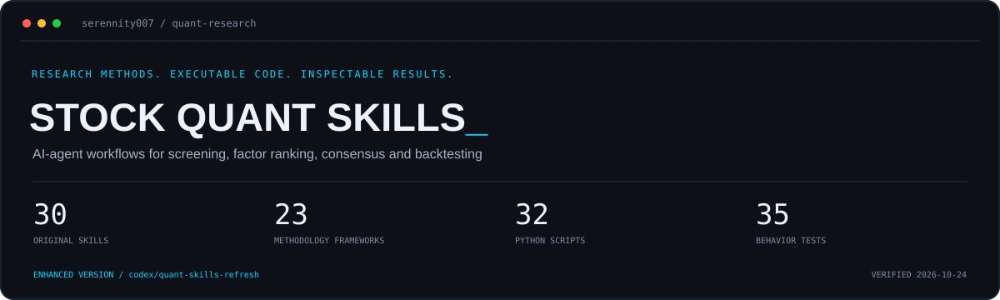

[English](README.md) · [简体中文](README.zh-CN.md) · [日本語](README.ja.md)



# AI 选股与量化投研工具链

`awesome-stock-quant-skills`

[](https://github.com/Serennity007/awesome-stock-quant-skills/stargazers) [](https://github.com/Serennity007/awesome-stock-quant-skills/forks) [](LICENSE)

将价值、成长、动量、宏观周期与资产配置方法实现为 Agent Skills 和 Python 脚本，支持财务筛选、因子打分、多框架共识与含交易成本的回测。面向 A 股研究，并提供美股热门股追踪。

**31 个原创 Skill · 23 套投资方法参考框架 · 33 个 Python 脚本 · 60 项本地测试通过。**

GitHub 已获 **41 Stars / 8 Forks**（截至 2026-10-24）。原创实现、第三方来源快照与外部资源索引分别维护；16 个第三方来源目录收录 225 份 `SKILL.md`。

<!-- inventory: originals=31 mirrors=16 vendored=225 -->

**[一条命令离线演示](docs/quickstart.md) · [验证范围](docs/validation.md) · [真实取数记录](examples/verification/2026-10-24/buffett-check.json)**

## 第一次使用：先跑两个离线示例

默认分支已包含 31 个原创 Skill、数据校验与回测功能，无需切分支。安装演示依赖后，一条命令运行共识排序和回测核算两个独立的合成场景，生成可阅读报告、CSV、输入哈希和运行日志。

```bash
git clone https://github.com/Serennity007/awesome-stock-quant-skills.git
cd awesome-stock-quant-skills
python -m pip install -r requirements-demo.txt
python scripts/run_demo.py
```

打开终端提示的 `output/demo/run-…/REPORT.md`。每次运行创建新目录，不覆盖已有产物；缺依赖会给出安装命令，计算失败会写入失败状态并非零退出。**示例使用合成数据，只核对程序行为。** [完整上手说明](docs/quickstart.md)。

## 黄金、原油、欧线与大 A 股指：独立 Skill

跨市场研究已拆成四个可单独使用的仓库，每个自带方法、数据规范、离线脚本、模拟示例和测试。

**[涛涛的期货研究：按板块分析与实操](https://github.com/Serennity007/taotao-futures-research)**

期货总 Skill 按11个研究板块组织，提供共同区间比较、量仓、多周期与产业数据报告，可以独立运行。以下四个仓库保留各自专题工具。

| 研究对象 | 独立仓库 | 重点 |
|---|---|---|
| 黄金 | [gold-research-skill](https://github.com/Serennity007/gold-research-skill) | 利率美元、多周期结构、关键位确认与失效 |
| 原油 | [crude-oil-research-skill](https://github.com/Serennity007/crude-oil-research-skill) | 供需与运输冲击、跨月曲线、价差与时效 |
| 欧线 EC | [ec-shipping-research-skill](https://github.com/Serennity007/ec-shipping-research-skill) | 有效运力、运价传导、按公布时点过滤的 SCFIS 对比 |
| 大 A 股指 | [a-share-index-research-skill](https://github.com/Serennity007/a-share-index-research-skill) | 指数结构、市场宽度、大小盘风格与成交集中度 |

新研究优先使用对应独立仓库；各项目无需安装本合集，示例均标注为模拟数据。本合集仍以个股选股与量化研究为主要入口。

## 合集内的黄金研究版本

本仓库保留 **[gold-cross-asset-research](my-skills/gold-cross-asset-research/SKILL.md)**：用时间窗口、H4 主结构、H1/M30 触发、MA/MACD 与关键位收回组织黄金研究，并分别验证白银、原油和集运欧线 EC 的传导。原有链接和计算示例继续可用。

- 分开记录个人观点、数据事实和可执行触发，允许金油方向未知，不用既有偏空观点覆盖反证。
- 保存“近期偏空金银/偏多原油”与“2026 年 3 月重点看多 EC、金油方向不确定”的分时段个人回顾，未补成已验证的收益战绩。
- 附本地 OHLC 校验脚本与 48 根合成 K 线示例：按明确截止时间计算 MA/MACD、边界观察、参照柱数与窗口过期；不请求行情或生成交易指令。

[结构方法](my-skills/gold-cross-asset-research/references/structure-method.md) · [跨资产传导与官方来源](my-skills/gold-cross-asset-research/references/cross-asset-map.md) · [历史观点的证据口径](my-skills/gold-cross-asset-research/references/evidence-and-cases.md) · [合成输出](my-skills/gold-cross-asset-research/references/example-output.json)

## 模拟记录与复盘

已写入两套可直接阅读的记录：

- **真实筛选快照，待建仓**：[2026-10-25 起始记录](reports/paper/2026-10-25/INITIAL_REVIEW.md)。冻结 20 只股票输入，14 只完整、6 只不完整；按公开规则生成观察清单，无后续价格时不编造持仓或收益。
- **合成数据账户，两次复盘**：[首次观察](examples/paper/journal/reviews/2026-08-31.md)、[第二次观察](examples/paper/journal/reviews/2026-09-30.md)。演示整手买入、费用、剩余现金、持仓损益及基准比较，包含亏损示例。历史日期是场景标签，实际创建于 2026-10-25。
- **可继续追加**：`scripts/paper_journal.py start / review` 保存输入、参数、价格、人工备注和哈希链；同日记录禁止覆盖。每日报告分开展示完整与不完整数据，现有定时脚本会保存独立的待建仓快照。

[功能说明与复现命令](docs/paper-journal.md) · [本日数据质量报告](reports/latest.md)。这些是模拟研究产物，不代表实盘经历或盈利证明。

## 你可以用它完成什么

| 研究任务 | 已有实现 | 可以检查的产物 |
|---|---|---|
| 财务质量与估值初筛 | 巴菲特、芒格、李录等参考框架 | ROE、毛利率、现金流、估值分位及分项扣分 |
| 成长、动量与题材研究 | 林奇、费雪、CANSLIM、热点扫描与概念映射 | 增长指标、相对强度、板块和候选清单 |
| 比较不同选股框架 | 多框架百分位归一化与共识排序 | 共识分、覆盖数、输入哈希与参数记录 |
| 检查框架的历史表现 | 月度调仓、漂移后换手与交易成本计算 | 毛净收益、持仓明细、基准和数据清单 |

## 值得关注的工程实现

**任务路由、数据取数、规则评分、共识排序、历史检验**可以按研究目标组合。Python 脚本支持直接运行，Agent 按需加载 Skill；CSV 与 JSON 记录把计算结果留在本地，便于检查和二次分析。

当前版本已落实年报期对齐、估值日期与 TTM 字段核对、缺失财务状态、共识输入校验，以及回测交易成本和持仓审计。参考方法覆盖 16 个海外投资方法 Skill 与 7 个国内投资方法 Skill；这些是公开方法的规则化参考实现。

## 个人实测与验证

2026-10-24 使用 **AKShare 1.19.3**，完成 **600519 单股真实财务取数与筛选计算**，取得 **2021–2025 五个年报期间**，估值交易日为 **2026-10-23**。35 项行为测试覆盖财务缺失、估值日期、共识校验、换手和成本等行为。

原始 JSON、筛选 CSV、验证范围和本地复现命令均已公开。实测说明取数与计算链路已验证；收益与策略有效性需要另行检验。

## 核心能力，经得起看代码和重跑

本轮优先升级**巴菲特财务筛选、单股估值、框架回测与共识衔接**，把会改变研究结果的日期、缺失数据和收益计算问题落实到脚本里。

| 能力 | 实际行为 | 验证入口 |
|---|---|---|
| 估值有明确时间口径 | TTM 字段精确匹配；历史按日期排序并截取五年窗口；同一交易日的价格和 PE 推算 EPS | [估值数据契约](my-skills/buffett-value-investing/scripts/research_data.py)、[回归测试](tests/test_buffett_data.py) |
| 缺失财务数据有明确状态 | ROE、毛利率、现金流按年报期对齐；单年毛利率不冒充五年稳定；`partial` 评分优先补数 | [筛选器](my-skills/buffett-value-investing/scripts/screen.py)、[评分规则](my-skills/buffett-value-investing/references/scoring_rules.md) |
| 共识有数据门槛 | 拒绝无效代码、重复、重名、默认情况下不同的股票池，以及声明为不完整的财务评分；保留输入哈希 | [共识合成器](my-skills/master-ensemble/scripts/ensemble.py) |
| 回测不根据未来缺价预选股 | 先按调仓时点选股，再计算持有收益；已选持仓缺少退出价时终止；基准按相同实际交易日计算 | [回测引擎](my-skills/framework-backtest/scripts/backtest.py)、[回归测试](tests/test_backtest.py) |
| 毛收益、成本、净收益可逐期核对 | 价格漂移后计算调仓额，首期建仓和换股买卖分别计成本；输出持仓、进出价格、换手与缓存哈希 | [可重跑的合成场景](examples/backtest/SCENARIO.md) |
| 研究流程按任务选择 | 按需调用相关 skill，并核对筛选、共识、回测产物是否满足解释条件 | [研究工作流](my-skills/quant-research-workflow/SKILL.md)、[产物契约](my-skills/quant-research-workflow/references/data-contracts.md) |

**2026-10-25 本地验证：60 项本地测试通过。** 此前在 2026-10-24 使用 AKShare 1.19.3 跑通单股实时筛选，取得 2021–2025 五个年报期间，估值交易日为 2026-10-23。[原始实跑记录](examples/verification/2026-10-24/buffett-check.json)与 [CSV](examples/verification/2026-10-24/buffett-screen.csv)可直接查看。它证明这条取数与计算链路跑通，不代表所有接口可用或策略盈利。

“31 / 16 / 225”是可由脚本复核的目录统计，分别指原创 skill、第三方来源目录和第三方 `SKILL.md` 文件。完整范围见 [验证记录](docs/validation.md)。上游更新检查以 [巡检模板](docs/workflows/upstream-watch.yml)提供，启用条件见 [维护说明](docs/maintenance.md)。

## 快速开始

### 先用一分钟跑通本地链路

以下是**合成数据**，只验证计算和产物，不访问行情服务，不需要 API key。请从仓库根目录执行：

```bash
git clone https://github.com/Serennity007/awesome-stock-quant-skills.git
cd awesome-stock-quant-skills
python -m pip install pandas
python my-skills/master-ensemble/scripts/ensemble.py --csvs examples/ensemble/quality.csv examples/ensemble/momentum.csv --out output/consensus.csv
```

预期得到：

| 代码 | 共识分 | 顶级命中数 | 覆盖框架数 |
|---|---:|---:|---:|
| 000003 | 83.3 | 1 | 2 |
| 000001 | 66.7 | 1 | 2 |
| 000002 | 50.0 | 0 | 2 |

同时生成 `output/consensus.csv.meta.json`，记录输入哈希、参数和运行时间。样例没有真实数据日期，所以 `as_of` 为 `null`。完整字段见 [master-ensemble](my-skills/master-ensemble/SKILL.md)。

### 再跑一遍有成本、有持仓明细的回测链路

同样使用**合成数据**，无需行情服务：

```bash
python my-skills/framework-backtest/scripts/backtest.py --cache-dir examples/backtest/cache --results-dir output/backtest-demo --frameworks danbin --start 2026-07-31 --top 1 --min-stocks 2 --cost-bps 10
```

输入价格人为设为 `100 → 110 → 99`。首期建仓成本为 10 bps，持仓不变的下一期不再次收费，期末不强制清仓。两期净期末资产应为 **0.98901**，基准为 **1.01**；可以逐项核对 `bt_result_danbin.csv`、`bt_holdings_danbin.csv` 与 `bt_manifest.json`。[完整场景说明](examples/backtest/SCENARIO.md)。

### 接入真实研究数据

```bash
python -m pip install akshare pandas numpy
python my-skills/buffett-value-investing/scripts/screen.py --codes 600519,000858,600036 --out output/buffett.csv
```

输出同时包含分项得分、财报期间、估值交易日、数据问题和运行记录。先看 `score_status` / `decision`；`partial` / `needs_data` 优先补数，不按总分直接列为候选。

真实取数依赖网络、数据源与接口版本；成功以实际输出为准。请记录行情交易日、财报期间和包版本。旧 Demo 中的价格、评分和样本日期均不能当作今天的结果。

### 在 Agent 中按需安装

把需要的**单个 skill 文件夹**复制到助手的技能目录。例如使用通用 `~/.agents/skills/` 目录的环境：

```bash
mkdir -p ~/.agents/skills
cp -r my-skills/quant-research-workflow ~/.agents/skills/
cp -r my-skills/buffett-value-investing ~/.agents/skills/
cp -r my-skills/master-ensemble ~/.agents/skills/
```

Windows PowerShell：

```powershell
New-Item -ItemType Directory -Force "$HOME/.agents/skills" | Out-Null
Copy-Item -Recurse my-skills/quant-research-workflow,my-skills/buffett-value-investing,my-skills/master-ensemble "$HOME/.agents/skills/"
```

Claude Code 可改用 `~/.claude/skills/`。第三方多技能合集要复制内部含 `SKILL.md` 的具体子目录，例如 `skills/agiprolabs__claude-trading-skills/skills/walk-forward-validation/`。导航器只负责选择流程，所需 skill 和数据依赖仍须安装。

可直接提出这样的任务：

> 用 quant-research-workflow 组织研究：对这三家公司做财务质量初筛，注明数据日期、各项扣分理由，以及需要人工判断的护城河问题。
>
> 对同池同日的质量与动量 CSV 做共识排序，说明共有因子、覆盖数和冲突，保留输入来源。
>
> 检查一个框架过去三年的表现，先列出历史成分、实际披露时间和交易成本能否满足，再解释回测结果。

## 按任务选技能

| 研究目标 | 从这里开始 |
|---|---|
| 不知道选哪个，或需要串联流程 | [quant-research-workflow](my-skills/quant-research-workflow) |
| 公司质量、护城河与安全边际 | [buffett](my-skills/buffett-value-investing)、[munger](my-skills/munger-quality-investing)、[li-lu](my-skills/li-lu-value-compounding) |
| 成长、GARP 与强势股 | [lynch](my-skills/lynch-garp-investing)、[fisher](my-skills/fisher-growth-15)、[CANSLIM](my-skills/oneil-canslim) |
| 低估、防御与红利 | [graham](my-skills/graham-defensive-investing)、[klarman](my-skills/klarman-margin-safety)、[neff](my-skills/neff-low-pe-total-return) |
| A 股题材与美股热门股 | [hot-theme](my-skills/hot-theme-scanner)、[concept-mapper](my-skills/concept-stock-mapper)、[us-tracker](my-skills/us-hot-stocks-tracker) |
| 指数估值、资产配置与周期 | [bogle](my-skills/bogle-index-investing)、[dalio](my-skills/dalio-all-weather)、[marks](my-skills/howard-marks-cycle) |
| 多框架交集与历史检验 | [master-ensemble](my-skills/master-ensemble)、[framework-backtest](my-skills/framework-backtest) |

## 原创技能


本仓库作者（Serennity007）原创的技能，放在 `my-skills/` 目录，与 `skills/` 收录区区分：

### 研究工作流入口

| 目录 | 简介 | License |
|---|---|---|
| [quant-research-workflow](my-skills/quant-research-workflow) | 按研究任务选择和串联 skill，核对接口、数据时点与结论证据，生成可追溯的研究结果 | MIT |

### 投资大师方法论系列

| 目录 | 简介 | License |
|---|---|---|
| [buffett-value-investing](my-skills/buffett-value-investing) | A股巴菲特式价值投资分析：护城河评估、连续5年ROE/毛利率/负债率/经营现金流筛选、安全边际估值（基于 akshare，含筛股与单股分析脚本） | MIT |
| [munger-quality-investing](my-skills/munger-quality-investing) | A股芒格优质企业投资法：连续5年ROIC/ROE、低负债、高稳定毛利率、盈利质量、少股本稀释五维质量打分 | MIT |
| [lynch-garp-investing](my-skills/lynch-garp-investing) | A股彼得·林奇GARP十倍股筛选器：PEG、连续盈利增长、低负债率、林奇六分类标签 | MIT |
| [graham-defensive-investing](my-skills/graham-defensive-investing) | A股格雷厄姆防御型投资七准则筛股器：规模、流动比率、连续盈利、连续分红、盈利增长、低PE/PB量化筛选 | MIT |
| [dalio-all-weather](my-skills/dalio-all-weather) | A股达利欧全天候/债务周期参考配置：用宽基指数、国债ETF、黄金ETF与商品指数计算相关性、波动率与风险平价权重，并回测年化/最大回撤/夏普 | MIT |
| [howard-marks-cycle](my-skills/howard-marks-cycle) | A股霍华德·马克斯周期温度计：沪深300/中证全指估值分位、股债收益差、成交热度、两融趋势，合成0-100周期位置评分并输出行动框架 | MIT |
| [soros-reflexivity](my-skills/soros-reflexivity) | A股索罗斯反身性/宏观投机扫描器：在价格动量与基本面的裂缝中标记正反馈/负反馈阶段与潜在拐点 | MIT |
| [druckenmiller-macro-flex](my-skills/druckenmiller-macro-flex) | 德鲁肯米勒式宏观灵活仪表盘：用akshare跟踪美元/人民币汇率、中美10Y国债收益率、黄金、原油、铜、A股指数及个股的近N日趋势与动量，输出多空倾向快照 | MIT |
| [livermore-trend-trading](my-skills/livermore-trend-trading) | A股杰西·利弗莫尔趋势投机：识别N日新高关键点突破、放量确认、缩量回踩二次入场与单日反转/放量滞涨危险信号，输出信号表与金字塔仓位试探框架 | MIT |
| [simons-factor-quant](my-skills/simons-factor-quant) | A股西蒙斯式多因子打分器：动量/反转/波动率/量能/均线偏离五维合成综合因子分并输出排名 | MIT |
| [klarman-margin-safety](my-skills/klarman-margin-safety) | A股卡拉曼安全边际深度价值筛选：PB/PE历史分位、市值/净现金比、52周高点回撤四把尺子，剔除ST与亏损股 | MIT |
| [templeton-global-contrarian](my-skills/templeton-global-contrarian) | A股邓普顿极度悲观逆向扫描器：52周位置、PE/PB自身历史低分位、缩量企稳、盈利为正，输出逆向买入观察清单 | MIT |
| [fisher-growth-15](my-skills/fisher-growth-15) | A股费雪成长股15要点机械化：营收CAGR成长跑道、研发费用率、毛利率趋势、连续ROE、盈利含金量、财务保守六维打分，为"闲聊法"调研筛出候选 | MIT |
| [neff-low-pe-total-return](my-skills/neff-low-pe-total-return) | A股约翰·聂夫低市盈率投资法：个股PE相对全市场中位数折价、(增速+股息率)/PE≥2总回报率黄金标准、股息率跨度年化、基本面底线七维打分 | MIT |
| [bogle-index-investing](my-skills/bogle-index-investing) | A股约翰·博格指数投资法：宽基指数PE/PB近10年分位估值温度计、博格公式预期收益三项拆解（股息率+盈利增速+估值回归）、定投档位参考、月定投vs一次性回测 | MIT |
| [oneil-canslim](my-skills/oneil-canslim) | A股威廉·欧奈尔CANSLIM七要素打分器：C最新季净利润同比≥25%、A年度增长、N距250日新高、S量能、L相对沪深300超额强度、I机构持股、M大盘50日线，逐字母通过表+池内RPS百分位 | MIT |

### 国内投资大佬系列

| 目录 | 简介 | License |
|---|---|---|
| [duan-yongping-business-first](my-skills/duan-yongping-business-first) | A股段永平"商业模式第一"六维打分：毛利率稳定性、连续ROE、经营现金流/净利润、低负债、盈利稳定、行业内龙头排名，"敢为天下后"筛选好生意 | MIT |
| [zhang-lei-longterm](my-skills/zhang-lei-longterm) | A股张磊高瓴长期结构性价值投资：连续双增、长期投入（研发/资本开支）、行业空间、ROE趋势四维成长质量雷达，"时间的朋友"筛选器 | MIT |
| [qiu-guolu-simple-rules](my-skills/qiu-guolu-simple-rules) | A股邱国鹭"投资中最简单的事"三好打分器：好行业（数月亮不数星星）、好公司（龙头+高ROE）、好价格（PE/PB历史分位） | MIT |
| [feng-liu-weak-side](my-skills/feng-liu-weak-side) | A股冯柳弱者体系逆向扫描：52周回撤、PE/PB三年历史分位、基本面未崩（盈利为正+营收未失速）、低关注度，输出赔率/概率逆向观察清单 | MIT |
| [lin-yuan-monopoly-consumer](my-skills/lin-yuan-monopoly-consumer) | A股林园垄断+成瘾性消费投资法：嘴巴相关刚需龙头、毛利率≥50%、ROE≥15%、高分红、申万消费/医药行业过滤多维打分 | MIT |
| [dan-bin-rose-of-time](my-skills/dan-bin-rose-of-time) | A股但斌"时间的玫瑰"伟大企业投资法：长坡（营收CAGR）、厚雪（高毛利率定价权）、复利引擎（连续ROE）、时间的玫瑰（财年归属精确年化分红）、含金量、财务健康、成长质量七维打分 | MIT |
| [li-lu-value-compounding](my-skills/li-lu-value-compounding) | A股李录价值复利投资法：长期高ROE、复利趋势（近2年vs前3年不失速）、利润再投资成长、盈利含金量、PE/PB历史低分位安全边际、低负债六维打分 | MIT |

### 热点题材系列

| 目录 | 简介 | License |
|---|---|---|
| [hot-theme-scanner](my-skills/hot-theme-scanner) | A股热点题材扫描器：基于akshare概念板块与资金流向接口，识别近N日最热题材、列出领涨股并输出结构化热度表 | MIT |
| [us-hot-stocks-tracker](my-skills/us-hot-stocks-tracker) | 美股热门AI股追踪器：内置AI算力/存储/AI应用/robotaxi主题清单，输出现价、涨跌幅、20/60日动量、52周高低位距离、成交量异动快照表 | MIT |
| [concept-stock-mapper](my-skills/concept-stock-mapper) | A股题材关键词→概念股映射器：用akshare概念板块接口模糊匹配板块，取成分股并按涨幅/换手/主力资金排序，支持多关键词题材强度对比 | MIT |

### 系列联动

| 目录 | 简介 | License |
|---|---|---|
| [master-ensemble](my-skills/master-ensemble) | 大师共识筛选器：把任意多个大师 skill 的打分结果 CSV 按框架内百分位归一化，合成共识分与顶级命中数，输出"多个框架同时覆盖"的跨框架交集标的（纯本地合成，秒级） | MIT |
| [framework-backtest](my-skills/framework-backtest) | 大师框架回测验证器：月度调仓回测各大师 skill 的打分框架在 A 股的历史真实表现（等权持有前 N 名 vs 沪深300），固定 120 天财报滞后近似（尚非严格 point-in-time），输出毛净收益、成交额成本、持仓审计、年化/超额/最大回撤/夏普与逐年对照表 | MIT |

### 原有

| 目录 | 简介 | License |
|---|---|---|
| [technical-pattern-recognition](my-skills/technical-pattern-recognition) | A股技术形态识别：均线多头/空头排列、MACD 金叉死叉、放量突破 N 日新高、缩量回踩均线，输出信号表（基于 akshare 新浪日线） | MIT |

## 第三方收录

以下 16 个来源目录保留上游署名与许可证。部分包含多个 skill；接口、密钥和运行环境要求各不相同。


| 目录 | 简介 | 来源 | License |
|---|---|---|---|
| [simonlin1212__a-stock-data](skills/simonlin1212__a-stock-data) | A股全栈数据 SKILL | [simonlin1212/a-stock-data](https://github.com/simonlin1212/a-stock-data) | Apache-2.0 |
| [wbh604__UZI-Skill](skills/wbh604__UZI-Skill) | 游资UZI炒股 Skill（深度分析/龙虎榜/陷阱识别等） | [wbh604/UZI-Skill](https://github.com/wbh604/UZI-Skill) | MIT |
| [BitSoulTech__BitSoulStockSkill](skills/BitSoulTech__BitSoulStockSkill) | A股选股+因子+回测（核心目录，assets 未收录） | [BitSoulTech/BitSoulStockSkill](https://github.com/BitSoulTech/BitSoulStockSkill) | Apache-2.0 |
| [fadewalk__serenity-stock-choke](skills/fadewalk__serenity-stock-choke) | A股"卡脖子"选股 | [fadewalk/serenity-stock-choke](https://github.com/fadewalk/serenity-stock-choke) | MIT |
| [shouldnotappearcalm__a-share-skill](skills/shouldnotappearcalm__a-share-skill) | A股分析+选股+模拟交易（多个技能子目录） | [shouldnotappearcalm/a-share-skill](https://github.com/shouldnotappearcalm/a-share-skill) | MIT |
| [StanleyChanH__Tushare-Finance-Skill](skills/StanleyChanH__Tushare-Finance-Skill) | Tushare 数据技能包 | [StanleyChanH/Tushare-Finance-Skill-for-Claude-Code](https://github.com/StanleyChanH/Tushare-Finance-Skill-for-Claude-Code) | MIT |
| [Geralt-L__Stock-Analysis-3D](skills/Geralt-L__Stock-Analysis-3D) | 3D 评分股票分析 | [Geralt-L/Stock-Analysis-3D](https://github.com/Geralt-L/Stock-Analysis-3D) | MIT |
| [atorber__qmt-trading-skill](skills/atorber__qmt-trading-skill) | QMT 交易 21 个 skills | [atorber/qmt-trading-skill](https://github.com/atorber/qmt-trading-skill) | MIT |
| [staruhub__a-share-analyst](skills/staruhub__a-share-analyst) | A股分析师技能（取自 ClaudeSkills） | [staruhub/ClaudeSkills](https://github.com/staruhub/ClaudeSkills) | MIT |
| [tradermonty__claude-trading-skills](skills/tradermonty__claude-trading-skills) | 美股分析 / CANSLIM 选股等 | [tradermonty/claude-trading-skills](https://github.com/tradermonty/claude-trading-skills) | MIT |
| [agiprolabs__claude-trading-skills](skills/agiprolabs__claude-trading-skills) | 67 个交易 skills（含加密/期权/风控） | [agiprolabs/claude-trading-skills](https://github.com/agiprolabs/claude-trading-skills) | MIT |
| [zubair-trabzada__ai-trading-claude](skills/zubair-trabzada__ai-trading-claude) | 16 个 trade-* skills + 5 agents | [zubair-trabzada/ai-trading-claude](https://github.com/zubair-trabzada/ai-trading-claude) | MIT |
| [yennanliu__InvestSkill](skills/yennanliu__InvestSkill) | 美股分析 + stock-screener 等 | [yennanliu/InvestSkill](https://github.com/yennanliu/InvestSkill) | MIT |
| [tellmefrankie__ai-investment-skills](skills/tellmefrankie__ai-investment-skills) | 期权流/新闻情绪/价格提醒等 5 个投资 skills | [tellmefrankie/ai-investment-skills](https://github.com/tellmefrankie/ai-investment-skills) | MIT |
| [cruisekkk__trading-ledger](skills/cruisekkk__trading-ledger) | 交易日志 skill | [cruisekkk/trading-ledger](https://github.com/cruisekkk/trading-ledger) | MIT |
| [AlexLiu0130__ibkr-options-assistant](skills/AlexLiu0130__ibkr-options-assistant) | IBKR 期权助手 | [AlexLiu0130/ibkr-options-assistant](https://github.com/AlexLiu0130/ibkr-options-assistant) | MIT |

## 验证、更新与贡献

```bash
python -m pip install pandas pyyaml
python scripts/validate_repository.py
python -m unittest discover -s tests -v
python scripts/check_upstreams.py
```

前三条构成离线验证；最后一条需要联网。质量与巡检工作流以 [待启用模板](docs/workflows) 交付，质量模板覆盖 Python 3.11 / 3.13。当前 GitHub 授权缺少 `workflow` 权限，尚未部署新工作流；获得相应权限后将模板放入 `.github/workflows/` 并推送到默认分支即可启用，详见 [维护说明](docs/maintenance.md)。

本次升级日期：**2026-10-24**。第三方代码仍为历史快照；旧来源未记录提交号时，巡检如实标记，不能宣称已经同步最新版。[本次验证](docs/validation.md)与[历史运行记录](docs/historical-demos.md)分别查看。

欢迎提交可复现的问题：目标 skill、命令、包版本、数据日期、预期与实际输出。贡献新 skill 时说明适用任务、依赖、输入输出与验证方式；更新转载内容时保留许可证、署名并记录上游提交。

## 使用边界与许可

本项目用于学习和研究，不构成投资建议。投资大师系列是公开方法的规则化近似，不代表本人背书或真实交易体系复刻。评分、共识和历史回测均不证明未来收益。涉及实盘交易的第三方能力须另行核对其权限和执行行为。

原创技能采用 MIT；整理内容采用根目录 [MIT License](LICENSE)。第三方作品归各自作者所有，以各目录原许可证为准，来源与转载范围见 [NOTICE](docs/NOTICE.md)。当前收录政策仅复制 MIT / Apache-2.0 / BSD / CC0 项目，其余仅作链接索引；这是一项收录政策，不是对其他许可证法律效果的判断。
